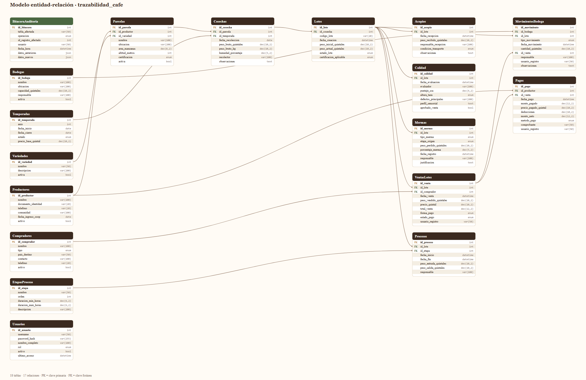

# CaféTrack

Sistema web de **trazabilidad y control de existencias de café** para cooperativas de
Alta Verapaz, Guatemala.

El sistema sigue cada lote desde el corte en la parcela hasta el pago al productor:
cosecha → acopio → beneficiado → catación → bodega → venta → pago.

La aplicación **escribe** siempre a través de procedimientos almacenados: las reglas
de negocio viven en MySQL, no en C#. El acceso exige sesión y cada rol se conecta con
su propio usuario de MySQL, así que los permisos los hace cumplir el motor y no solo
la interfaz.

**En números:** 18 tablas, 11 vistas, 14 procedimientos, 2 funciones, 4 triggers y un
usuario de MySQL por cada uno de los 5 roles.



---

## Tecnología

- ASP.NET Core **Razor Pages**, C#, `nullable` habilitado.
- **MySQL Server** local (`localhost:3306`), base `trazabilidad_cafe`.
- Acceso a datos con **Dapper + MySqlConnector**. Sin Entity Framework, sin migraciones:
  el esquema lo define únicamente el script SQL.
- CSS propio en `wwwroot/css/cafetrack.css` y JavaScript sin librerías en `wwwroot/js/`.
  Sin Bootstrap, sin jQuery, sin frameworks.
- Tipografías de Google Fonts: Fraunces, Source Sans 3, IBM Plex Mono.
- Iconos de [Lucide](https://lucide.dev) (licencia ISC), copiados al proyecto y escritos
  en línea; ver `CafeTrack.Web/wwwroot/img/ICONOS.md`.
- Formato guatemalteco (`es-GT`): fechas `dd/MM/yyyy`, moneda `Q` con dos decimales.

> **Versión del SDK.** El proyecto apunta a `net9.0`. Para compilarlo con .NET 10 basta
> con cambiar `<TargetFramework>` en `CafeTrack.Web/CafeTrack.Web.csproj`; no hay más
> dependencias de versión.

---

## Estructura del repositorio

```
CafeTrack/
├── .gitignore
├── CafeTrack.sln
├── README.md
├── docs/
│   └── diagrama-er.png / .svg / .pdf   modelo entidad-relación
├── sql/
│   ├── CafeTrack_completo.sql   todo lo siguiente en un solo archivo, en orden
│   ├── 01_estructura.sql        18 tablas
│   ├── 02_datos_prueba.sql      datos ficticios de Alta Verapaz
│   ├── 03_usuario_app.sql       CREATE USER + GRANT para cafetrack_dev
│   ├── 04_rutinas.sql           función de existencia, procedimientos y 4 triggers
│   ├── 05_datos_demo.sql        (opcional) un lote sin acopio
│   ├── 06_seguridad.sql         usuarios de la app, sp_login y un usuario MySQL por rol
│   ├── 07_vistas.sql            las 11 consultas de reporte, como vistas
│   ├── 08_usuarios.sql          gestión de usuarios y contraseñas temporales
│   ├── 09_recuperar_acceso.sql  recuperación cuando nadie puede entrar
│   ├── 10_operacion.sql         beneficiado, catación, bodega y pagos por rol
│   ├── 11_ventas_pagos.sql      existencia por bodega, venta y compradores
│   └── 12_traslados.sql         traslado de café entre bodegas
└── CafeTrack.Web/
    ├── Program.cs               autenticación, políticas por rol y servicios
    ├── appsettings.json                     sin credenciales
    ├── appsettings.Development.json.example plantilla de referencia
    ├── Models/         POCOs de cada tabla + ViewModels
    ├── Data/           fábrica de conexiones por rol y repositorios Dapper
    ├── Helpers/        formato, traducción de errores de MySQL, exportación a Excel
    ├── Pages/          una carpeta por módulo (ver "Pantallas")
    └── wwwroot/        css/, js/ e img/
```

---

## Instalación en una PC nueva (Windows)

1. **Instalar** el SDK de .NET (9 o 10), MySQL Server y Git.

2. **Clonar el repositorio**

   ```bash
   git clone https://github.com/eurizar/CafeTrack.git
   cd CafeTrack
   ```

3. **Cargar la base de datos.** Como `root`, en un solo paso:

   ```bash
   mysql -u root -p < sql/CafeTrack_completo.sql
   ```

   Crea la base desde cero (incluye `DROP DATABASE IF EXISTS`): tablas, datos de ejemplo,
   rutinas, vistas y usuarios por rol. Equivale a ejecutar los scripts numerados en este
   orden: `01, 02, 03, 04, 06, 07, 08, 10, 11, 12`. Quedan aparte dos opcionales:

   ```bash
   mysql -u root -p < sql/05_datos_demo.sql        # un lote recién cosechado, sin acopio
   mysql -u root -p < sql/09_recuperar_acceso.sql  # solo si nadie puede entrar
   ```

   > Si MySQL responde `ERROR 1418` al crear las funciones, ejecute una sola vez como root:
   > `SET GLOBAL log_bin_trust_function_creators = 1;`

4. **Cambiar las contraseñas de MySQL.** Los scripts traen `CAMBIAR_ESTA_CLAVE` como
   contraseña de `cafetrack_dev` y de los usuarios por rol. Asigne las reales:

   ```sql
   ALTER USER 'cafetrack_dev'@'localhost' IDENTIFIED BY '...';
   ALTER USER 'cafetrack_gerente'@'localhost' IDENTIFIED BY '...';
   -- igual para cafetrack_admin, cafetrack_acopiador, cafetrack_catador y cafetrack_auditor
   ```

5. **Configurar los secretos** con esas contraseñas:

   ```bash
   cd CafeTrack.Web
   dotnet user-secrets set "ConnectionStrings:CafeTrack" "Server=localhost;Port=3306;Database=trazabilidad_cafe;User=cafetrack_dev;Password=...;"
   dotnet user-secrets set "ConnectionStrings:CafeTrack:gerente" "Server=localhost;Port=3306;Database=trazabilidad_cafe;User=cafetrack_gerente;Password=...;"
   # igual para admin, acopiador, catador y auditor
   ```

   Las contraseñas **nunca** se guardan en `appsettings.json` ni en ningún archivo del
   repositorio. `appsettings.Development.json.example` sirve solo como plantilla.

6. **Ejecutar**

   ```bash
   dotnet run --project CafeTrack.Web
   ```

   La consola muestra la URL (por ejemplo `https://localhost:7xxx`).

---

## Pantallas

| Ruta | Pantalla |
|---|---|
| `/` | Panel: productores activos, lotes registrados, quintales en bodega y ventas de la temporada |
| `/Catalogo` | Café y proceso: variedades, flujograma, etapas del beneficiado y certificaciones |
| `/Productores` | Listado con búsqueda por nombre o comunidad |
| `/Parcelas` | Productor, variedad, altitud, área y certificación |
| `/Lotes` | Listado con filtros por estado y temporada |
| `/Lotes/Detalle/{codigo}` | Trazabilidad completa del lote, por ejemplo `/Lotes/Detalle/CAF-2026-001` |
| `/Existencias` | Kardex resumido por bodega y lote |
| `/Acopios/Registrar` | Recepción en acopio (acopiador) |
| `/Procesos/Registrar` | Etapa del beneficiado (acopiador) |
| `/Calidad/Registrar` | Catación (catador) |
| `/Bodegas/Ingresar` | Ingreso a bodega (acopiador) |
| `/Bodegas/Trasladar` | Traslado entre bodegas (acopiador) |
| `/Ventas/Registrar` | Venta (gerente) |
| `/Compradores` | Compradores y altas (gerente) |
| `/Pagos` | Pendientes de pago y pagos hechos (gerente) |
| `/Pagos/Registrar` | Pago al productor (gerente) |
| `/Reportes` | Los 11 reportes, uno por vista, con descarga a Excel |
| `/Bitacora` | Auditoría: lo que escriben los triggers y los procedimientos |
| `/Bitacora/Detalle/{id}` | Desglose de un registro: estado anterior, nuevo y el JSON crudo |
| `/Pruebas/Errores` | Diagnóstico: provoca `SIGNAL`, `CHECK` y `ERROR 1142` para ver cómo se traducen |
| `/Usuarios` | Gestión de usuarios y roles (solo `admin`) |
| `/Cuenta/CambiarClave` | Cambio de contraseña del propio usuario |
| `/Cuenta/Ingresar` | Inicio de sesión |

---

## Decisiones de diseño

- **El esquema lo manda el SQL.** La aplicación no crea ni modifica tablas. No hay
  migraciones ni ASP.NET Identity.
- **La existencia no se almacena.** Se calcula desde `MovimientosBodega`: los movimientos
  de tipo `'Entrada'` suman y todos los demás restan.
- **Columnas GENERATED de solo lectura.** `peso_bruto_kg`, `total_venta` y `monto_neto`
  nunca aparecen en un `INSERT` ni en un `UPDATE`.
- **`documento_identidad` no se consulta.** Ninguna consulta de la aplicación selecciona
  esa columna, y el POCO `Productor` ni siquiera la mapea.
- **Valores ENUM sin tildes.** La base conserva `'Organico'` y `'Credito 30 dias'` tal
  como los define el script. La tilde se agrega solo al mostrarlos, con `Helpers/Formato.Enum`.
- **Una fábrica de conexiones por rol.** `IDbConnectionFactory` abre la conexión con el
  usuario de MySQL que corresponde al rol de la sesión (admin, gerente, acopiador,
  catador o auditor).
- **Errores amables.** Si MySQL no responde, la aplicación muestra una página explicativa,
  nunca la excepción cruda ni la cadena de conexión.

---

## Lógica en la base de datos

**Funciones**

- `fn_existencia_lote(id_lote)`: quintales del lote en todas las bodegas.
- `fn_existencia_lote_bodega(id_lote, id_bodega)`: quintales del lote en una bodega.

**Triggers**

| Trigger | Momento | Qué hace |
|---|---|---|
| `trg_movimientos_validar` | BEFORE INSERT en `MovimientosBodega` | Impide sacar de una bodega más de lo que hay de ese lote, que entre un lote sin catación aprobada y que se exceda la capacidad de la bodega |
| `trg_movimientos_estado` | AFTER INSERT en `MovimientosBodega` | Pone el lote en `'En bodega'` o `'Vendido'` y escribe en la bitácora |
| `trg_mermas_descuento` | AFTER INSERT en `Mermas` | Descuenta el peso del lote y registra `ALERTA_MERMA_ALTA` si supera el 15 % |
| `trg_ventas_precio` | AFTER INSERT en `VentasLotes` | Registra `ALERTA_PRECIO_BAJO` si el precio queda bajo el precio base de la temporada |

Los errores se levantan con `SIGNAL SQLSTATE '45000'` y llegan a la pantalla como un
aviso en español; `Helpers/ErroresMySql.cs` traduce además las violaciones de `CHECK`
y los errores de permisos.

**Recarga de datos.** `02_datos_prueba.sql` trae los pesos y estados ya calculados, así
que levanta la bandera `@cafetrack_carga` mientras inserta y los triggers se saltan el
cuerpo. Por eso los scripts se pueden volver a ejecutar aunque las rutinas ya existan.

### La cadena completa, rol por rol

Cada paso del proceso tiene su pantalla y su procedimiento, y cada rol solo ve —y solo
puede ejecutar— lo que le toca:

| Paso | Rol | Pantalla | Procedimiento |
|---|---|---|---|
| Acopio | acopiador | `/Acopios/Registrar` | `sp_registrar_acopio` |
| Beneficiado | acopiador | `/Procesos/Registrar` | `sp_registrar_proceso` |
| Catación | catador | `/Calidad/Registrar` | `sp_registrar_calidad` |
| Ingreso a bodega | acopiador | `/Bodegas/Ingresar` | `sp_registrar_ingreso_bodega` |
| Traslado entre bodegas | acopiador | `/Bodegas/Trasladar` | `sp_trasladar_lote` |
| Venta | gerente | `/Ventas/Registrar` | `sp_registrar_venta` |
| Alta de compradores | gerente | `/Compradores` | `sp_crear_comprador` |
| Pago | gerente | `/Pagos/Registrar` | `sp_registrar_pago` |

**El lote avanza solo cuando corresponde:**

- No se puede saltar una etapa del beneficiado: la anterior tiene que estar cerrada.
- **Las fechas solo avanzan**: una etapa no puede empezar antes de que cierre la anterior,
  ni antes de que el lote llegara al centro de acopio, ni en el futuro.
- De una etapa no sale más café del que entró, y la diferencia se anota sola como merma.
- Si una etapa quedó abierta, la misma pantalla la cierra en lugar de duplicarla.
- Solo se cata lo que terminó las siete etapas, una sola vez por lote, y no se puede
  aprobar con menos de 80 puntos SCA. Si no aprueba, el lote queda `'Rechazado'`.
- A bodega entra solo lo aprobado, nunca más de lo que el lote tiene ni más de lo que
  cabe en la bodega.
- Solo se vende lo que hay **en la bodega que despacha**.
- Una venta se paga una sola vez, y las deducciones no pueden superar el monto.

**La separación la hace MySQL, no la interfaz.** Si un rol intenta un procedimiento
ajeno, el motor responde `ERROR 1370`; si intenta escribir en una tabla que no le
corresponde, `ERROR 1142`. La pantalla solo traduce el mensaje.

### La existencia se mide por bodega

`fn_existencia_lote_bodega` cierra un hueco de la primera versión: la salida por venta se
validaba contra la existencia del lote en toda la cooperativa, así que se podía despachar
desde una bodega café guardado en otra —la bodega de salida quedaba en negativo y la otra
con café que ya no existía. Hoy lo revisan tanto `sp_registrar_venta` como el trigger
`trg_movimientos_validar`, y la pantalla solo ofrece las bodegas que tienen ese lote.

### Traslado entre bodegas

`MovimientosBodega.tipo_movimiento` no tiene un valor `'Traslado'`, y la tabla no se toca.
`sp_trasladar_lote` escribe **dos movimientos en una transacción**: un `'Ajuste'` que resta
en la bodega de origen y una `'Entrada'` que suma en la de destino. Si la bodega de destino
no tiene capacidad, el trigger rechaza la entrada y no queda ninguno de los dos.
**Traslada quien custodia el café**: acopiador y admin. El gerente vende, pero no mueve
existencias.

### Por qué no hay un rol "vendedor"

`Usuarios.rol` es un `ENUM('admin','gerente','acopiador','catador','auditor')`: agregar
un rol sería alterar la tabla. **El gerente es el vendedor**, y además liquida al productor.
Concentrar venta y pago en un mismo rol es una debilidad de control: quien fija el precio
de venta también fija lo que se le paga al productor. Separarlo no exige un rol nuevo
—basta mover `/Pagos` a `admin`— y queda anotado como decisión consciente.

### Modo demostración

Un secado dura entre 100 y 240 horas: para mostrar o capacitar sobre el flujo completo
hay que poder cerrar la etapa con una fecha que todavía no llega. Ese tope —y solo ese— se
levanta con:

```bash
dotnet user-secrets set "CafeTrack:PermitirFechasFuturas" "true"
```

Con el ajuste encendido, `sp_registrar_proceso` recibe `p_permitir_futuras = TRUE` y acepta
fechas futuras; la pantalla lo avisa en un recuadro. **El orden entre etapas se sigue
exigiendo igual.** Sin el ajuste (lo que viene en el repositorio), rige la regla estricta.

---

## Reportes

**Las 11 consultas de reporte son vistas.** `sql/07_vistas.sql` las crea; el SQL vive en
la base y la aplicación solo hace `SELECT` sobre ellas.

| Vista | Responde |
|---|---|
| `vw_existencias_bodega` | ¿Cuánto café hay hoy en cada bodega, lote por lote? |
| `vw_trazabilidad_lote` | La historia completa de cada lote, de la parcela al estado actual |
| `vw_produccion_productor` | ¿Cuánto entregó cada socio y cuánto se le ha pagado? |
| `vw_mermas_lote` | ¿Dónde se está perdiendo el café y cuánto? |
| `vw_calidad_lotes` | Puntajes SCA, altura de taza y resultado de cada catación |
| `vw_ventas_detalle` | Cada venta con su comprador y cómo quedó frente al precio base |
| `vw_ventas_temporada` | ¿Cómo le fue a la cooperativa en cada ciclo? |
| `vw_pagos_productor` | Cuánto recibió cada socio y qué parte del ingreso representa |
| `vw_rendimiento_variedad` | ¿Qué variedad rinde mejor y cuál se cotiza más alto? |
| `vw_tiempos_beneficiado` | ¿Cada etapa se cumplió dentro del rango esperado? |
| `vw_alertas_auditoria` | Las alertas de merma alta y precio bajo, con el JSON desplegado |

`/Reportes/Ver/{clave}` muestra cada una, con encabezado fijo al desplazar, filtro en vivo,
numeración de filas y una fila de totales para las columnas que tiene sentido sumar. El
nombre de la vista **nunca** llega desde la URL: viaja solo la clave y se resuelve contra
el catálogo de `Helpers/CatalogoReportes.cs`.

**Descarga a Excel.** Cada reporte genera un `.xlsx` real, con los encabezados en negrita,
las fechas como fechas y el dinero con formato de quetzales. `Helpers/ExportadorExcel.cs`
arma el archivo con `ZipArchive` —un `.xlsx` es un ZIP con unos XML adentro—, así que
**no hace falta ninguna librería externa**.

**Diagnóstico de errores.** `/Pruebas/Errores` provoca tres rechazos a propósito, dentro de
una transacción que siempre se deshace:

| Caso | Qué responde MySQL |
|---|---|
| Vender un lote rechazado en catación | `ERROR 1644` con el texto del `SIGNAL` |
| Registrar un acopio de −5 qq saltándose el procedimiento | `ERROR 3819`, restricción `chk_aco_peso` |
| Insertar un comprador con el usuario del rol | `ERROR 1142` con auditor, catador o acopiador; permitido con admin |

---

## Seguridad

**Contraseñas.** La tabla `Usuarios` no tiene columna de salt, así que el salt viaja
dentro de `password_hash` con el formato `<salt>:SHA2(salt + contraseña, 256)`. El salt
es distinto por usuario y se genera con `RANDOM_BYTES(16)`. La comparación ocurre dentro
de `sp_login`: la contraseña en claro nunca sale de la base ni se guarda en ningún lado.
`sp_cambiar_password` genera un salt nuevo en cada cambio.

**Usuarios iniciales.** Los crea `sql/06_seguridad.sql`, todos con la contraseña
`Cafe2026!` (cámbiela antes de cualquier uso real):

| Usuario | Rol | Qué puede hacer |
|---|---|---|
| `admin` | admin | Todo, incluida la gestión de usuarios |
| `gerente` | gerente | Ventas, compradores y pagos al productor |
| `acopiador` | acopiador | Acopio, beneficiado, ingreso a bodega y traslados |
| `catador` | catador | Catación |
| `auditor` | auditor | Solo lectura, incluida la bitácora |

**Un usuario de MySQL por rol.** Al iniciar sesión, la aplicación busca la cadena
`ConnectionStrings:CafeTrack:<rol>` en User Secrets y abre la conexión con
`cafetrack_<rol>`, cada uno con sus propios `GRANT`. Si una cadena no está configurada,
cae a la de desarrollo. El login mismo usa la cadena por omisión, porque todavía no se
conoce el rol. Así la restricción es doble: la interfaz esconde lo que no corresponde al
rol y, si alguien llega igual, MySQL lo rechaza.

**Bitácora.** `BitacoraAuditoria` se llena sola desde los triggers y los procedimientos:
ingresos, salidas y traslados de bodega, ventas, acopios, inicios de sesión y los intentos
fallidos. La aplicación no inserta ahí por su cuenta. La pantalla `/Bitacora` la ven
`admin` y `auditor`; cada fila abre su desglose completo, donde se comparan
`datos_anteriores` y `datos_nuevos` lado a lado.

### Gestión de usuarios

La pantalla `/Usuarios`, solo para `admin`, permite crear usuarios, cambiar su rol,
activarlos o desactivarlos y asignarles una contraseña temporal. Todo pasa por los
procedimientos de `sql/08_usuarios.sql`, que validan con `SIGNAL` y escriben en la
bitácora. La base no deja al sistema sin administrador activo ni repetir un nombre de
usuario.

**Contraseñas temporales sin tocar el esquema.** La marca viaja dentro del propio hash
con un prefijo:

```
TMP:<salt>:<hash>      contraseña temporal, hay que cambiarla
<salt>:<hash>          contraseña que el usuario eligió
```

`sp_login` detecta el prefijo; mientras esté, la aplicación devuelve al usuario a
`/Cuenta/CambiarClave` en cualquier ruta que intente abrir. La clave temporal se genera
en bloques legibles (`Cafe-7K3M-R9TX`, sin caracteres que se confundan) y se muestra
**una sola vez**.

### Si nadie puede entrar

La contraseña no se recupera: solo está guardado su hash. Lo que se hace es reemplazarla.

1. **Lo normal:** otro usuario con rol `admin` entra a `/Usuarios` y le asigna una
   contraseña temporal. Por eso conviene tener **dos administradores**; la pantalla lo
   advierte cuando solo hay uno.
2. **Si no queda ningún administrador con acceso:** edite el usuario y la clave temporal
   en `sql/09_recuperar_acceso.sql` y ejecútelo como `root`:

   ```bash
   mysql -u root -p < sql/09_recuperar_acceso.sql
   ```

   Al entrar con esa clave, el sistema exige registrar una propia. El script también
   sirve para reactivar un usuario o devolverle el rol `admin`, y todo queda en la bitácora.

Un administrador **no puede reiniciarse a sí mismo** desde `/Usuarios`: en su propia fila
la aplicación ofrece *Cambiar mi clave*, que exige conocer la actual.

---

## Datos de prueba

Todos los datos de `sql/02_datos_prueba.sql` son **ficticios**. Los nombres, teléfonos y
documentos no corresponden a personas reales; las comunidades de Cobán, San Pedro Carchá,
Senahú y San Cristóbal Verapaz se usan solo como ambientación.

Contiene 5 variedades, 7 etapas de beneficiado, 2 temporadas, 8 productores, 10 parcelas,
2 bodegas, 3 compradores, 12 cosechas con sus 12 lotes, 12 acopios (uno con 20 % de merma
por una volcadura), procesos con tiempos realistas, 7 evaluaciones de calidad (una
rechazada), 10 movimientos de bodega, 3 ventas y 3 pagos.

---

## Control de versiones

- `main` recibe solo cambios terminados y probados; el trabajo se hace en ramas aparte.
- Ningún archivo versionado contiene credenciales: `.gitignore` excluye `bin/`, `obj/`,
  `.vs/` y `*.user`, y las contraseñas de MySQL viven únicamente en User Secrets
  (`%APPDATA%\Microsoft\UserSecrets\`, fuera del repositorio).
